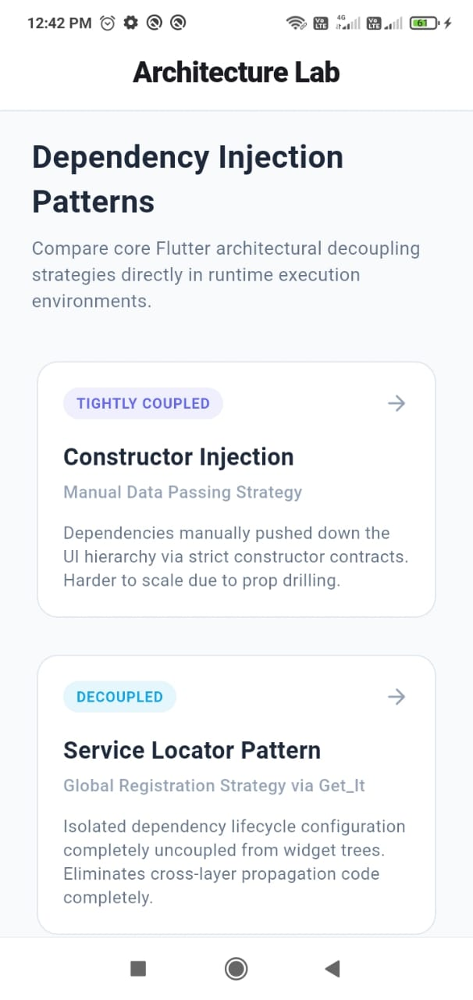
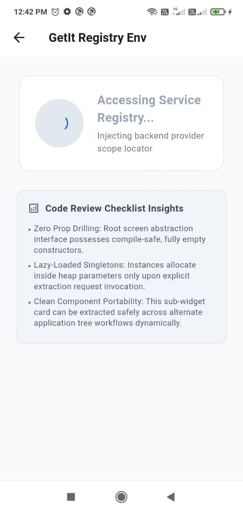

# Flutter Dependency Injection Showcase

A portfolio demonstration app highlighting the architectural differences between **Manual Constructor Injection** and **Service Locator Pattern (using Get_It)**.

---

## 📸 Screenshots

| Dashboard Overview | Constructor Injection | Service Locator Pattern |
| :---: | :---: | :---: |
|  |  |  |

---

## Architectural Comparison

### 1. Manual Constructor Injection (Without GetIt)

* **Prop Drilling:** The `ApiService` class has to be initialized at the route level and manually passed down through every single child widget constructor.
* **Tight Coupling:** Components down the UI tree are forced to remain aware of system dependencies.

### 2. Service Locator Pattern (With GetIt)

* **Loose Coupling:** Deeply nested UI components pull dependencies directly from `GetIt` completely decoupled from widget constructors.
* **Cleaner Maintenance:** Adding or modifying constructors doesn't break code layers between initialization and usage.
